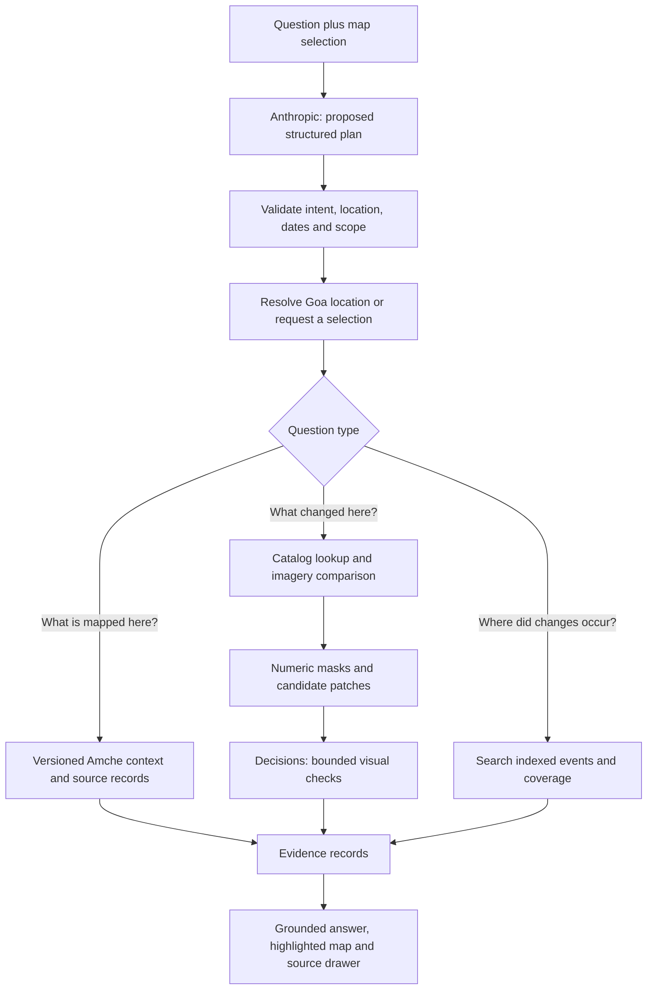

# Goa map intelligence: observations, local context and natural-language questions

Working plan, 28 October 2026. Scope: Goa only. This document separates proposed product behaviour from the implementation and verification status recorded at the end. It is not a claim that monitoring is already live.

## The product we are building

A person should be able to ask **“Where has tree canopy disappeared in the last 10 days?”**, see the places the system actually examined, and open the observations supporting each possible change. They should then be able to ask **“Which of those overlap notified private forests?”**, **“Was there any evidence of fire?”**, or **“Show me the earlier image.”**

The useful unit is an **investigation with evidence**, not a chatbot paragraph or a stack of unrelated map layers. Each result connects a location, an observation interval, an observable change, relevant local records, and an explicit account of what remains unknown.

Recommended first release: an authenticated, on-demand investigation of a selected area, up to 25 km². Follow it with a searchable Goa-wide event index. Recurring notifications come only after retrieval, comparison and field evaluation work. Do not make each question trigger an unrestricted scan of the whole state.

### What an answer should look like

Illustrative wording, not an observed finding:

> Possible canopy loss is visible in three patches in the selected area. Open a patch to compare its dated images. One change interval lies entirely within your requested 10 days; two overlap that window but may have begun earlier. Parts of the area could not be assessed because of cloud or shadow. These observations do not establish whether trees were cut, burned or lost for another reason.

The map highlights the actual candidate polygons. Each result provides the before/after images, acquisition timestamps, patch area, visibility, spectral evidence, contextual records and source links. It must not turn “no usable observations” into “no change.”

## Give each source a specific job

| Source | What it contributes | How we use it | What it cannot establish alone |
| --- | --- | --- | --- |
| Amche Atlas | Goa location search; survey plots; village/local-body context; forests, wetlands, water bodies, khazans, plans and related source records | Adopt selected configuration ideas and permitted datasets in a controlled layer registry; preserve original provenance | Current tree cover, exact event timing, ownership or an infringement |
| Copernicus Data Space / Sentinel-2 L2A | Dated optical imagery, reflectance, scene classification and acquisition metadata | Primary on-demand observation source through the hardened EVE-derived adapter | Reliable individual-tree counts, proof of cutting, or guaranteed clear imagery in a 10-day interval |
| NASA FIRMS | Dated active-fire / thermal-anomaly observations | Join detections near a candidate and within its observation interval; show sensor footprint and timing | That every fire was detected, or that one hotspot identifies a specific tree/plot |
| OpenAI Decisions | Fixed classifications of supplied evidence | Narrow questions with an explicit uncertain outcome | A narrative report, a validated accuracy guarantee, a spatial database or authoritative field truth |
| Anthropic | Interpret a question and, later, explain supplied evidence | Produce validated query plans; cite only returned evidence identifiers in explanations | Invent places, acquisition dates, spatial joins, events or causation from model memory |
| NASA OPERA disturbance products | A potential source of precomputed candidate changes | Evaluate availability over Goa before adopting for broad-area candidate discovery | Automatic proof of deforestation or a substitute for local validation |

Amche's default satellite backgrounds and its contextual layers have different update schedules. Do not assume a map's display date is the image capture date, or that one provider is always newer. Compare actual acquisition metadata and usable coverage. Amche's inspected timelapse uses annual frames for 1984–2022; it is historical context, not a recent ten-day detector. [Amche source](https://github.com/publicmap/amche-atlas/tree/0ef70e319560f0008d53ced1923358956133c6d9), [timelapse implementation](https://github.com/publicmap/amche-atlas/blob/0ef70e319560f0008d53ced1923358956133c6d9/timelapse/index.html).

The inspected EVE revision is `a49119dedcb7e929b69b7d78912dd52665c871fc`. Its CDSE code is useful retrieval infrastructure, but its original image wrapper does not provide sufficient acquisition provenance for temporal claims. The hosted adaptation must add that provenance, authentication and bounded execution. [EVE CDSE code](https://github.com/eve-esa/mcp-tool-registry/tree/a49119dedcb7e929b69b7d78912dd52665c871fc/servers/cdse).

## Make Amche genuinely useful inside ActForGoa

Start with these layer families, without importing its entire application or replacing ActForGoa's React framework and design:

1. **Finding places:** village names and aliases, taluka, survey number and plot outlines. Distinguish identically named villages. The Amche cadastral search index returns centroids, not plot geometry; obtain the outline from the separate cadastral layer before treating a whole plot as the area of interest.
2. **Ecological context:** notified private forests, wetlands, water bodies and khazan-related layers. A notification boundary and observed canopy are different facts and should have different map styles and labels.
3. **Planning context:** regional plans, coastal plans, draft/notified distinctions and land-use changes. Preserve the status and date of each version. Describe overlaps as context, not a legal conclusion.
4. **Historical context:** old maps and timelapse. Offer them as optional comparison material with their dates and alignment limitations.

The current Goa configuration includes concrete sources for these layers, including a water-body atlas, cadastral plots, notified private forests and draft/notified coastal maps. Those sources are externally hosted and must be checked individually. [Goa layer registry](https://github.com/publicmap/amche-atlas/blob/0ef70e319560f0008d53ced1923358956133c6d9/config/goa.atlas.json), [cadastral search contract](https://github.com/publicmap/amche-atlas/blob/0ef70e319560f0008d53ced1923358956133c6d9/docs/CADASTRAL-SEARCH.md).

For every adopted layer, record:

- Stable ID, display title, geometry type and supported operations: display, selection, intersection, distance, or text lookup.
- Original publisher, intermediary/curator, source URL, licence, attribution and inspected version/hash.
- Date represented, effective date where available, last upstream update, our fetch time and last successful validation. These are separate fields.
- Coordinate system, positional uncertainty, draft/notified/historical status, geographic coverage and known gaps.
- Hosting mode: permitted local snapshot, live service, or link-only. Mark failed sources unavailable without taking down satellite retrieval.

Only versioned **vector geometry** can support precise automated intersections. A scanned/georeferenced map can be displayed; it cannot silently become a precise polygon dataset. Record transformation and digitisation evidence when such a layer is converted. Intersections near uncertain boundaries must carry that qualification.

Review and allowlist source URLs, layer types and styles. Do not execute arbitrary JavaScript from Amche configurations, adopt an open proxy, copy a maintainer's service credentials, or feed untrusted layer HTML directly into the UI. Amche's repository LICENSE permits software reuse; its package metadata names a different permissive licence, and external datasets/services retain their own terms. Preserve the upstream licence/attribution and resolve the metadata mismatch before substantial source vendoring. [Repository licence](https://github.com/publicmap/amche-atlas/blob/0ef70e319560f0008d53ced1923358956133c6d9/LICENSE).

## Natural language becomes a checked spatial query



Use a small typed query contract, not model-generated SQL or arbitrary tool execution:

```json
{
  "intent": "canopy_loss",
  "scope": "selected_area",
  "area_id": "server-resolved-area-id",
  "window": {"relative_days": 10, "timezone": "Asia/Kolkata"},
  "time_semantics": "change_interval_overlaps_window",
  "context_filters": [{"layer_id": "notified-private-forests", "operation": "intersects"}],
  "minimum_patch_area_m2": 900,
  "include_uncertain": true,
  "limit": 50
}
```

This is the target contract; the first adapter supports the four observation intents, selected/named/statewide scope and date interpretation. Context filters and indexed-event queries are subsequent work.

The server resolves relative dates against an explicit clock in Asia/Kolkata and stores UTC instants. It validates geometry against a Goa boundary, area limits, date span, known layer IDs and supported operations. A model cannot change those limits. Named places resolve through a gazetteer with stable IDs, locality/taluka and aliases; ambiguous names return candidates. Until the gazetteer is available, the map selection is required and the model must not guess coordinates.

Persist conversation **references**, not implicit geography: selected area ID, current result-set ID, time window, visible layer IDs and selected event ID. “Only near wetlands” filters the last result set; “show the earlier image” opens the selected event's actual evidence. When a reference has expired or is ambiguous, ask one focused question. Give users visible editable area and time controls so they can correct interpretation.

Keep query understanding, observations and explanatory prose separate. A valid JSON plan can still misunderstand a place or period, so evaluate meaning as well as schema validity. If the language provider fails, manual area/date controls remain usable. [Anthropic tool contracts](https://platform.claude.com/docs/en/agents-and-tools/tool-use/strict-tool-use).

## Answering “what trees have been cut down in the last 10 days?”

### 1. Resolve what is being investigated

If an area is selected, investigate that area. If the user explicitly requests all Goa, use the indexed mode when available and state its coverage. Do not silently substitute the visible map viewport for an explicit place name. Translate “trees cut” into **possible canopy-loss investigation**, retaining the user's wording but not asserting its cause.

Sentinel-2 visible/NIR bands are natively 10 m; SWIR and scene classification are 20 m. Upsampling does not improve their information content. A 10 m pixel is 100 m² and can contain several surfaces. Require multiple coherent pixels for candidates; the initial nine-pixel/900 m² floor is an engineering starting point, not a validated minimum detectable tree-loss area. A specific individual tree needs suitably licensed finer imagery or field evidence. [Sentinel-2 band and quality documentation](https://documentation.dataspace.copernicus.eu/APIs/SentinelHub/Data/S2L2A.html).

### 2. Retrieve observations with provenance

Query the CDSE catalog for the requested period and a preceding baseline interval. Expose the catalog's pagination/partial-result status. Keep scene IDs, footprints, acquisition timestamps, processing information and scene-wide cloud metadata. Process a selected acquisition on a fixed local ground grid; retain actual processing tile IDs/paths and timestamps. Stop if output provenance cannot be reconciled with the requested acquisition. [CDSE catalog](https://documentation.dataspace.copernicus.eu/APIs/SentinelHub/Catalog.html).

Do not present a least-cloudy mosaic spanning many dates as one observation. Search-window boundaries do not become acquisition dates. The first implementation uses selected pairs; a later time-series step searches all relevant clear observations to find the actual last clear presence and first clear absence.

### 3. Compare observable pixels

Use harmonized surface reflectance on the same CRS, grid origin, pixel size, geographic mask and extent. Mask missing data, cloud, cirrus, shadows, saturated pixels and uncertain scene classes. Buffer cloud/shadow edges. Report both per-observation visibility and the fraction observable in **both** images; a low scene-wide cloud percentage is not proof that the selected plot is clear.

Compute NDVI, water indices and burn indices from numeric spectral data. Retain quality masks and intermediate rasters. Compare paired pixels rather than independent whole-area averages. Detect connected candidate patches; do not classify an entire village with one averaged score. Before acceptance, add registration diagnostics and exclude or flag displaced edges; sharing a grid alone does not eliminate sensor/georeferencing error.

A vegetation decline is only a candidate. Check canopy appearance, crop/plantation context, seasonality, water/tide changes and persistence. Consult earlier seasons where necessary and a second post-change observation when available. Do not use a historical “forest” label as proof that every pixel was recently tree-covered. Broad-area products may help find candidates but need scene-level verification.

### 4. Ask Decisions narrow questions

For each candidate patch and its surrounding context, ask whether canopy is observable before, observable after, and whether the same location shows possible loss. Separate questions assess burn-like evidence, visible surface water and possible clearing/construction. Use choices such as `present`, `absent`, `uncertain` and `possible_loss`, `no_visible_loss`, `uncertain`.

The current API uses `POST /v1/decisions` with `gpt-6-luna`; it accepts image/text/JSON evidence and returns predicate, choice or score answers. It does not generate an arbitrary narrative report. Handle refusals and malformed/incomplete outputs. Its confidence values are model estimates, not measured field accuracy. [Decisions guide](https://developers.openai.com/api/docs/guides/decisions), [request/response reference](https://developers.openai.com/api/reference/resources/decisions/methods/create).

The initial adapter evaluates one selected pair. Candidate-crop evaluation, calibration and persistence checks are explicit acceptance work before statewide conclusions or alerts.

### 5. Preserve the time interval

For a change supported by observations, retain an open/closed interval `(last clear presence, first clear absence]`. Display both endpoints. Store first automated detection and later confirmation separately.

For example, if presence was clear 14 days ago and absence is clear 2 days ago, a question about the last 10 days gets **“the change interval overlaps your period; it may have happened earlier.”** It does not get a claim that the loss happened 2 days ago. Distinguish intervals fully inside the query window, overlapping it, and outside it. Allow an explicit “first detected in the last 10 days” filter, with that wording visible.

### 6. Join useful context and explain only supported conclusions

Intersect candidate geometry with versioned context layers in a spatial database; retain the exact layer version and overlap area. For “near wetlands,” require or show a distance definition and calculate in a metric projection. A bounding-box hit is not a precise intersection. Check temporal applicability when comparing a present-day notification with an older event.

Use FIRMS for corroborating thermal observations, not a binary “fire/no fire” verdict. Its API needs a separate free MAP_KEY; the current documented area endpoint returns at most five days per request, so split a ten-day period and deduplicate detections. Retain UTC acquisition time, sensor and spatial footprint. “No detection returned,” “coverage unavailable,” and “not queried” are different states. [FIRMS API](https://firms.modaps.eosdis.nasa.gov/api/area/), [NASA detection limitations](https://firms.modaps.eosdis.nasa.gov/alerts/notes.php).

The final reporting layer receives a bounded evidence bundle with immutable IDs. Require a citation for every factual finding and reject references that were not supplied. Deterministic templates should handle counts, dates, areas and coverage; Anthropic can explain relationships without rewriting the underlying facts. Contradictory sources remain visible. Satellite/context evidence never alone establishes ownership, legality, a responsible person, or a causal cutting/fire date.

## Make the whole map queryable, not just individual images

Use four connected stores in the mature service:

| Entity | Essential fields |
| --- | --- |
| Area / place | Stable ID, Goa geometry, taluka/village, aliases, source version and positional qualification |
| Observation | Scene and process IDs, acquisition time, footprint/grid, spectral assets, quality masks, retrieval and processing versions |
| Change event | Polygon, observable change type, before/after evidence IDs, interval, first detection, confirmation, alternatives and review state |
| Context association | Event ID, layer/version/feature ID, spatial relation, overlap/distance, validity dates and original-source citation |
| Coverage record | Cell/area, period, searched catalogs, usable observations, missing/cloudy area, processing status and freshness |
| Query run | Validated plan, normalized dates, dataset versions, selected evidence IDs, coverage, provider usage and completion status |

SQLite is sufficient for the first private bounded-job prototype. Move the spatial event/context/coverage records to PostgreSQL + PostGIS before general statewide queries. Keep image assets in private object storage and retain only metadata/references in the database. Use a queue with resumable jobs, idempotency and bounded concurrency. Give imagery, language planning and image classification separate persistent usage accounting; preserve the existing research service's unrelated budget ledger.

Indexing should work by Goa grid cells and acquisition updates, with cached scene/tile results and a watermark for each source. Record “searched but cloudy,” “not searched,” “processed with no candidate,” and “candidate found” separately. Query results need both a freshness timestamp and a coverage summary. A cached index cannot claim to have just checked the satellites.

Evaluate NASA OPERA DIST products as a candidate generator. NASA documents near-global 30 m disturbance products using optical HLS and Sentinel-1 inputs; availability and completeness for specific Goa dates must be verified before depending on them. Do not assume every GLAD/RADD product covers Goa because a worldwide portal can display the region. [NASA OPERA products](https://www.jpl.nasa.gov/go/opera/products/).

## Interface and access

Use an ActForGoa map route with an ordinary question box, a visible area/date summary, optional context layers, and results next to the map. A person can search a place, draw/select an area, ask a question and inspect a before/after pair. Desktop can use a map/results split; on phones keep the question, result list and selected evidence accessible without narrow side panels. Retain the existing upright typography, colours and controls.

Each event has an evidence drawer: image slider or side-by-side pair, dates, visibility, spectral measurements, alternatives and contextual records. Use different styles for observed changes and mapped notification/planning boundaries. Mark uncertain findings distinctly. Export a compact evidence report with source IDs, not a screenshot stripped of dates/provenance.

Reuse named-user admin sessions and CSRF protection. The browser calls same-origin authenticated routes; only the trusted backend knows the satellite service token. The Python service has health, query-plan, catalog, comparison-job and result endpoints. MCP exposes the same bounded operations behind a separate token; it does not expose local save paths, arbitrary evalscripts, provider secrets or other users' jobs. Keep the SDK below MCP 2 while using FastMCP 1.x.

The website stays on Vercel and the Python service is packaged for Railway, with a persistent private data directory, one worker initially, `0.0.0.0`/`PORT` binding and a health endpoint. The coordinator owns combined review-site promotion through the existing release workflow. No changes to actforgoa.org.

## Delivery sequence and acceptance gates

| Stage | Concrete delivery | Completion gate |
| --- | --- | --- |
| 0: Contracts and foundations | Cited plan; Goa area/date contracts; EVE-derived CDSE, Anthropic and Decisions adapters; protected REST/MCP; job/accounting controls | Offline tests establish scope/auth/uncertainty/provenance behaviour; provider availability is reported separately |
| 1: On-demand investigation | Map selection, natural-language plan, catalog scenes, dated pair comparison, visible uncertainty and evidence | Bounded real CDSE retrieval-to-classification check; private session/CSRF check; desktop/phone inspection |
| 2: Context and location resolution | Curated Amche registry, village/taluka/survey selection, versioned vector intersections, useful source links | Spot-check real Goa locations and boundaries; no guessed geometry; explicit unavailable layers and draft dates |
| 3: Defensible change evidence | Patch-level classification, temporal persistence, seasonal baselines, registration checks, FIRMS joins | Frozen representative Goa evaluation, reviewed false positives/misses, credible abstention and timing behaviour |
| 4: Queryable Goa event index | PostGIS, queued cell processing, cached observations, coverage ledger, contextual event filters and follow-ups | Statewide coverage/freshness honestly reported; query results are reproducible and agree with evidence records |
| 5: Optional notifications | User-selected areas/topics, reviewable alert rules and delivery | Explicit alert evaluation and opt-in; no alerts merely because a model returns high confidence |

Do not jump directly to stage 5. Stage 1 can deliver real value while the broader event index is developed.

### Evaluation before trusting answers

Build an initial frozen set of at least 40 Goa investigations with independently reviewed reference labels. Stratify across confirmed canopy loss, unchanged forest, plantations/harvest, seasonal leaf change, wetland/tidal changes, construction/clearing, burns where available, cloud/shadow, small targets below useful resolution and mismatched observations. Include north/south Goa, coast/interior, monsoon/dry periods and boundary-adjacent plots. Where reference truth is unavailable, label it unknown rather than assuming the satellite interpretation is truth.

Measure candidate-level precision/recall, false positives per investigated area, missed known changes, abstention/coverage, interval correctness and geometry overlap. Evaluate per class and season; do not reduce all performance to a single accuracy number. Freeze test cases and expected outcomes before tuning thresholds. Keep a held-out set; do not silently rewrite expected labels after failures.

Separately evaluate at least 30 query-understanding cases: relative dates, explicit dates, named-place ambiguity, scope changes, follow-up references, outside-Goa queries, unsupported questions, requested tree counts, malicious tool/SQL instructions and mismatched map selections. A schema-valid but semantically wrong plan fails.

Set release thresholds after reviewing the pilot baseline and the cost of false allegations/missed changes. Until then label the output exploratory. Save failed checks and provider usage; do not repeat unchanged paid failures or reset accounting. No current evidence supports a claimed accuracy percentage or a guaranteed maximum detection delay.

## Current implementation and access status

An isolated branch `codex/satellite-monitoring` starts from `7bf1965`. Foundation code is implemented under `satellite/`, with an authenticated admin-to-service bridge and `/map` frontend. The initial 28 satellite tests, 181 Node tests, build, desktop/phone fixture workflow and one live Anthropic planning request pass. See [verification evidence](../reports/satellite-2026-10-28/README.md) and [continuation handoff](SATELLITE-HANDOFF.md). It is not yet merged or live. See the verification report added with the implementation for the actual tests performed; this plan alone is not validation.

Continuation on 28 October recovered checkpoint `133bd4e`, reconciled main `a786df5`, and verified newly ready CDSE credentials with real OAuth, catalog and Process calls. A missing TAR Accept header was corrected in `deb1f1d`; the real 10/20 October pair now has verified acquisition provenance, aligned numeric bands and 100% common usable coverage. No vegetation-loss candidates met the exploratory thresholds in this one test area. See [live validation](../reports/satellite-live-2026-10-28/README.md). Tests now pass: 29 satellite Python, 181 Node and production build. This is retrieval validation, not field accuracy or full stage-1 classification acceptance.

The OpenAI secure picker previously selected a project and a 30-day key, but key creation/storage has not completed; no Decisions inference has run. Railway's control API returned Cloudflare 403 in the original executor; that historical result has not been retested by this imagery continuation. Deployment credential readiness does not prove API access. No hosted service or combined frontend release has been made.

Remaining source work must be recorded honestly: Amche contextual geometry ingestion, place resolution, statewide indexing, FIRMS integration, evidence-grounded conversation history, field evaluation and alerts are not completed by the initial adapters. Keep this plan and the cloud implementation ledger updated as each stage is accepted.
