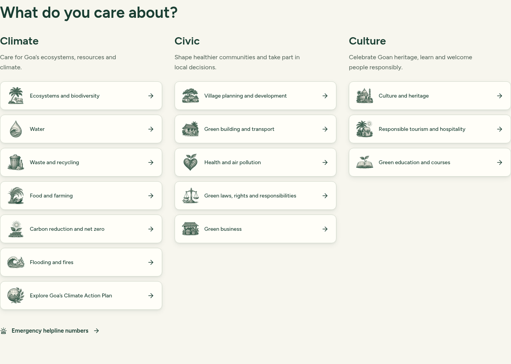
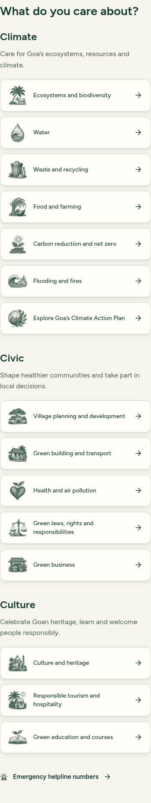
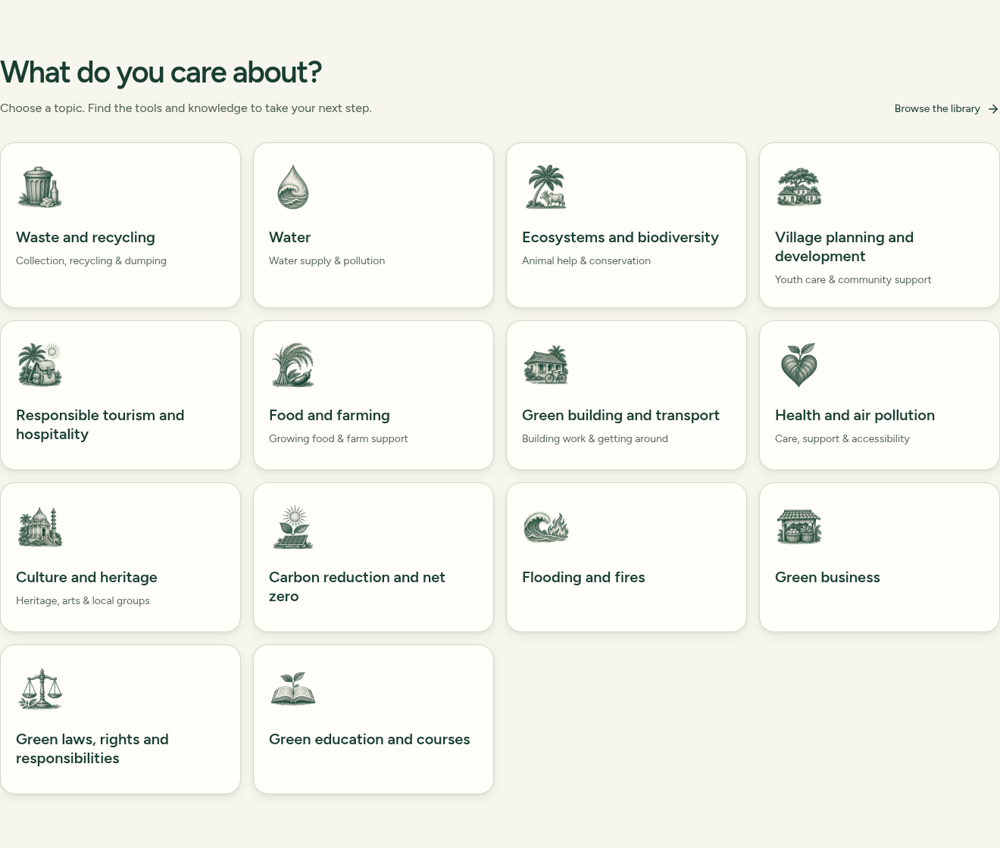
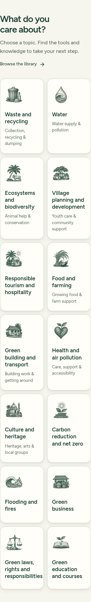

# Illustrated category buttons

Implemented on `codex/illustrated-category-icons`, based on freshly fetched `origin/main` at `ee2989b`. Implementation commit: `b9bbcc3ef843ceec75a72414c668669fefb2cba4`. [Draft PR #148](https://github.com/actforgoa2026/ActForGoa-website/pull/148) is open for review; not merged or deployed.

The main site's categories now use fifteen original illustrations matching the landing page's forest-green engraved palm, cow and temple artwork. The set covers all fourteen existing topics and the Climate Action Plan. The same topic artwork appears on the AI homepage and the fourteen topic headings. Specific action icons remain unchanged.

The existing Arc ButtonLink components, labels, descriptions, translations, destinations, focus treatment and responsive grids are preserved. Each illustration is decorative (`alt=""`, `aria-hidden="true"`), has explicit dimensions, loads lazily and uses proportional sizing. Unknown future categories retain their original TopicIcon. The image column grows from 24px to 48px on the main homepage; its buttons remain the same horizontal label-and-arrow composition. AI cards and topic headings use 64px art, reduced to 56px on phones.

## Artwork

The original landing motif pixels were visually inspected before generation. One coherent asset sheet was generated with the existing artwork as its reference, then the fifteen illustrations were individually extracted and exported with transparent padding. All exports are 192 × 192 WebP, totaling 346,906 bytes (339 KiB). They retain natural proportions, stippling, etched linework and pale interior highlights. No icon includes generated text.

Asset provenance, source image path, extraction regions and individual sizes are recorded in [`public/assets/topics/illustrations.json`](../../public/assets/topics/illustrations.json). The original generated PNG remains at `/workspace/generated_images/exec-36dad29e-bc72-481d-95ca-2185143f5d7a.png`. The existing landing artwork is unchanged.

## Verification

- `NODE_USE_ENV_PROXY=1 npm test`: **283 passed, 0 failed**. The initial unproxied run failed the remote MCP catalogue check; unchanged main reproduced it. The documented managed-cloud proxy setting resolved it without a source change.
- `npm run build`: **passed**, including TypeScript, server/API compilation, main Vite build and separate landing build.
- Real Chromium against the production build: **10 responsive layouts passed**, covering `/` and `/ai` at 1440, 1024, 768, 390 and 320px. All 15/14 images load, retain their aspect ratio, fit the controls and remain decorative. No horizontal page/control overflow or page exceptions; no failed asset requests.
- Compared labels, destinations, font family/size/weight/line-height, and accessible navigation snapshots with unchanged main at every width. They match. Verified Figtree actually loads, visible keyboard focus, tab order and category clicks to `/topics/water`.
- All fourteen topic headers load the correct image at 390px; `/topics/waste/segregation` retains its existing action icon. The separate `/landing/` still renders its original motifs without horizontal overflow.
- Hindi and Konkani main-page labels match unchanged main at 320px, without page/control overflow; touch navigation opens the Water topic in both languages. See [languages.json](languages.json).
- Actual pixels inspected for the generated sheet, main desktop, AI desktop, main tablet, main phone and narrow AI phone. The repository-requested Impeccable skill is absent from this executor; no automated Impeccable review is claimed.
- `git diff --check`: **passed**.

Machine-readable browser evidence: [verification.json](verification.json). Local raw logs, additional viewport screenshots and the browser verification script are under ignored `.reports/category-icons/`. Checks use local pages; no chat generation, report submission or release operation was performed.

## Rendered previews

Main homepage, desktop:

Main homepage, phone:

AI homepage, desktop:

AI homepage, narrow phone:

